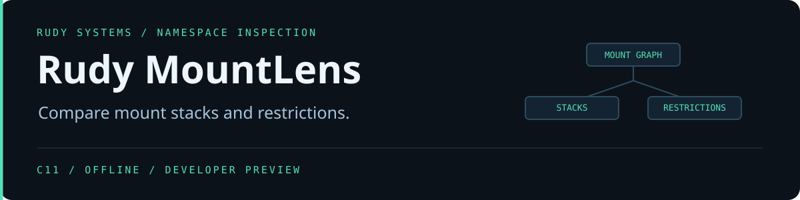

<p align="center"></p>

<p align="center">
<a href="https://github.com/r4venrudy/rudy-mountlens/actions/workflows/ci.yml"></a>

<a href="LICENSE"></a>
<a href="https://rudy.systems"></a>
</p>

**An `rw` mount can still sit on a read-only superblock.** Rudy MountLens reads Linux mountinfo snapshots, reconstructs parent links and direct mount stacks, and compares namespace restrictions by target. The implementation is C11 and runs offline on Windows, Linux, and macOS.

## Try the sample

Download a [native preview](https://github.com/r4venrudy/rudy-mountlens/releases), compare the archive's SHA-256 to its entry in `SHA256SUMS.txt`, and extract it.

```sh
bin/mountlens inspect examples/before.mountinfo
bin/mountlens compare examples/before.mountinfo examples/after.mountinfo --fail-on-relaxation
```

Use `bin\mountlens.exe` on Windows. The sample shows a direct stack at `/srv`, then a change that removes effective read-only and `nodev` restrictions at that target. It also includes an unresolved repeated target at `/review`.

To capture your own Linux namespace, run `cat /proc/self/mountinfo > before.mountinfo` inside the namespace you want to record. Capture the second snapshot in the intended context after the change.

## What the report measures

| Evidence | Meaning |
| --- | --- |
| Parent links and depth | Depth within the captured graph, with separate markers for self-root and parents outside the capture |
| Direct stacks | A mount is marked as shadowed at its target when a captured child with the same target references it as parent |
| Effective restrictions | Read-only if either the mount or superblock reports `ro`, plus the mount's `nosuid`, `nodev`, and `noexec` |
| Propagation | Shared, slave and unbindable markers, visible peer-group membership count, and the captured upstream labels |
| Snapshot comparison | Additions, removals, ambiguous targets and changes to backing, attachment, tracked propagation, restrictions or layer count |

Comparison groups records by decoded target path. Each side needs a unique candidate among the records with no same-target child. If either side has multiple candidates, the target is ambiguous. Mount and peer-group IDs are local to each capture. Comparison uses parent targets and propagation markers and counts, while inspection retains the raw IDs. A direct stack is evidence about recorded attachments. Kernel pathname resolution also depends on the surrounding namespace and can hide records through ancestor overmounts.

The comparison covers the four restrictions shown above, and it displays other options for context. A relaxation is the loss of a tracked restriction at a target with an identified candidate on both sides. Added and removed targets are reported separately.

## Exit codes and input limits

- **0** produces a report. With the gate enabled, this also means there are no confirmed relaxations or ambiguous targets.
- **1** indicates at least one confirmed relaxation with `--fail-on-relaxation`.
- **2** indicates malformed input, an I/O failure, or invalid usage.
- **3** indicates an inconclusive gated comparison because a target is ambiguous. Confirmed relaxations take precedence and return 1.

Input accepts Linux mountinfo records with LF or CRLF, including a final line without a newline. The parser limits each snapshot to 32 MiB, each record to 64 KiB, and each snapshot to 100,000 mounts. It decodes the kernel escapes for space, tab, newline and backslash, skips unknown optional fields, and checks duplicate IDs and parent cycles.

The JSON report preserves bytes in string values. ASCII is readable, and each other input byte is encoded as its corresponding `\u00XX` value. Encode a decoded string as Latin-1 to reconstruct its original bytes.

## Build and test

Use a C11 compiler and CMake 3.20 or newer. Python 3.9 or newer runs the test oracle and packaging script. Set `BUILD_TESTING=OFF` to build without Python.

```sh
cmake -S . -B build -DCMAKE_BUILD_TYPE=Release
cmake --build build --config Release --parallel 2
ctest --test-dir build -C Release --output-on-failure
cmake --install build --config Release --prefix stage
```

The independent oracle checks shuffled graphs, renumbered mount IDs, repeated targets, malformed snapshots, and a 12,000-record stack. CI runs Windows, Linux, macOS, and Linux with AddressSanitizer and UndefinedBehaviorSanitizer.

[Linux mountinfo format](https://man7.org/linux/man-pages/man5/proc_pid_mountinfo.5.html) · [Linux shared-subtree semantics](https://docs.kernel.org/filesystems/sharedsubtree.html)
